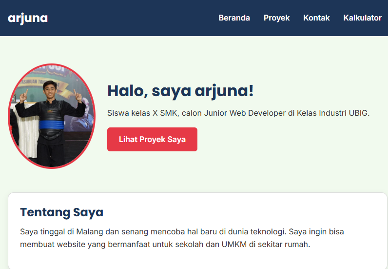

<<<<<<< HEAD
# portofolio-arjuna

Website portofolio pribadi yang saya buat di Kelas Industri UBIG 
=======
# Portofolio arjnuna
Website portofolio pribadi yang saya buat di Kelas Industri UBIG
>>>>>>> 9b65052 (feat: memperbarui halaman portofolio)
(Paket 1, Minggu 01 sampai 05).
Website ini tampil rapi di ponsel, tablet, dan laptop.
## Tampilan

## Fitur

- Halaman *Beranda* berisi profil, hobi, cita-cita, keahlian, dan 
  jadwal belajar
- Halaman *Proyek* berisi daftar proyek dalam bentuk kartu
- Halaman *Kontak* berisi form untuk menghubungi saya
- Tampilan responsif dengan Flexbox dan media query
## Teknologi

- HTML5
- CSS3 (Flexbox dan media query)
- Git dan GitHub
- VS Code dan Live Server
## Tautan
<<<<<<< HEAD

- Website: https://portofolio-arjuna-052.vercel.app/
- Dibuat oleh:Arjuna prananda imam maulana, SMKN 1 PASURUAN
- # portofolio-arjuna 
=======
- Website: https://portofolio-sindu-git-main-masychunsindu01.vercel.app/
- Dibuat oleh: arjnuna, SMKN 1 Pasuruan
>>>>>>> 9b65052 (feat: memperbarui halaman portofolio)
